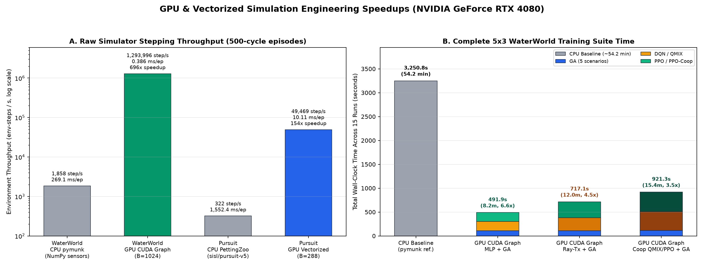
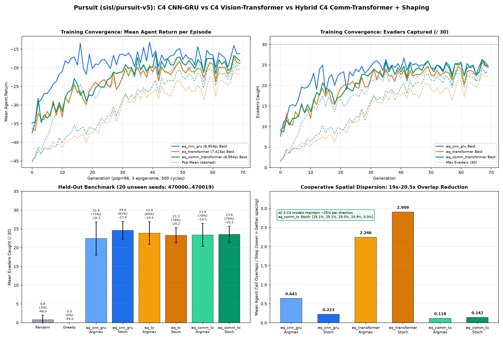
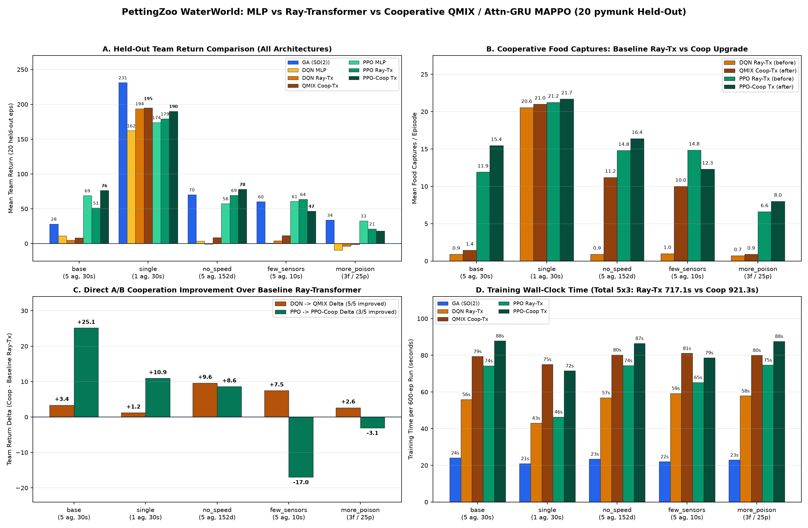

# Multi-Agent RL Research Benchmark: GPU Simulation, Equivariance & Transformers

Исследовательский репозиторий по глубокому многоагентному обучению с подкреплением (**Deep MARL**) на средах библиотеки **PettingZoo**. Проект объединяет два полноценных трека:

1. **[`waterworld_marl/`](waterworld_marl/README.md) — PettingZoo WaterWorld:** воспроизведение и существенная доработка экспериментов статьи МГТУ им. Н.Э. Баумана (Ш.Р. Гатиятуллин, науч. рук. д.т.н. А.Н. Алфимцев), перенос физики `pymunk` в **CUDA Graph** симулятор (**696×** ускорение), сравнение **SO(2)-эквивариантной нейроэволюции**, **Double DQN** и **CTDE MAPPO** в вариантах **`MLP`** и геометрического энкодера **`RayTransformerEncoder`**.
2. **[`pursuit_ga/`](pursuit_ga/README.md) — PettingZoo `sisl/pursuit-v5`:** нейроэволюция команды из 8 агентов с точной **C4-эквивариантностью**, рекуррентной памятью (`GRU`) и сравнением **`eq_cnn_gru`** vs **`eq_transformer`** (Vision-Transformer) на векторизованном GPU-симуляторе (**154×** ускорение).

> Подробное методологическое исследование, разбор статьи, таблицы по всем 5 сценариям и поведенческая аналитика: **[`docs/RESEARCH_REPORT.md`](docs/RESEARCH_REPORT.md)**.

---

## Архитектурная карта исследования

| Проект / Среда | Алгоритмы | Сравниваемые архитектуры | Симметрия / Инвариантность | Симулятор обучения (RTX 4080) | Проверка качества |
| --- | --- | --- | --- | --- | --- |
| **Pursuit** (`sisl/pursuit-v5`, 8 преследователей, 30 целей) | Генетический алгоритм (`GeneticAlgorithm`, `pop=96`, `70` поколений) + anti-overlap/flank shaping | `eq_comm_transformer` (`8,994` пар.) vs `eq_transformer` (`7,414`) vs `eq_cnn_gru` (`8,954`) + неэквивариантные `cnn`, `cnn_gru`, `transformer` | Точная **C4-эквивариантность** + межагентный Self-Attention ([`_AgentCommBlock`](pursuit_ga/networks.py)) | [`VectorizedPursuitGPU`](pursuit_ga/gpu_sim.py) (`49,469 env-steps/s`, `154×` vs CPU) | 20 held-out сидов `470000..470019` на официальной CPU-среде PettingZoo |
| **WaterWorld** (`waterworld`, 5 сценариев × 3 метода, `600` эпизодов) | `GA (SO(2) + CRN)`, `Double DQN` / **Hybrid QMIX**, `CTDE MAPPO` / **PPO-Coop (Attn-GRU + curriculum)** | [`RayTransformerEncoder`](waterworld_marl/algos/common.py) (`10.3K–18.9K`) vs `MLP` (`29.2K–128.1K`) vs [`WaterworldGAPolicy`](waterworld_marl/algos/ga.py) (`11–17` пар.) | Геометрический `[cos θ, sin θ]` readout + Cross-Agent Critic; точная **SO(2)-эквивариантность** в GA | [`VectorizedWaterworldGPU`](waterworld_marl/env/gpu_waterworld.py) CUDA Graph (`1,293,996 env-steps/s`, `696×` vs `pymunk`) | 20 held-out сидов `950000..950019` на `pymunk`-среде PettingZoo |

---

## Ключевые результаты и визуальное сравнение

### 1. Инженерное ускорение симуляции (CPU vs GPU / CUDA Graph)



- **WaterWorld:** время полного прогона всей матрицы (`5 сценариев × 3 алгоритма × 600 эпизодов`) снизилось с `3,250.8s` (`~54.2 мин` на CPU) до **`491.9s` (`8.2 мин`, `6.6×`)** с `MLP` и **`717.1s` (`12.0 мин`, `4.5×`)** с `RayTransformerEncoder`. Расхождение наблюдений GPU-симулятора с `pymunk` не превышает `1e-5`, а на CPU расчёт сенсоров ускорен векторизацией на NumPy (`atol < 1e-12`).
- **Pursuit:** 70 поколений (`pop=96 × 3 эп. = 288` параллельных сред + валидация элит) выполняются за **`511.7s`** (`7.31s/ген`, `eq_cnn_gru`) и **`528.3s`** (`7.55s/ген`, `eq_transformer`).

### 2. Pursuit (`sisl/pursuit-v5`): C4 Vision-Transformer vs C4 CNN-GRU



| Политика (`20` сидов `470000..470019`) | Параметров | Награда агента | Поймано (`/ 30`) | Поимок (%) | Full clear | Перекрытий / шаг |
| --- | ---: | ---: | ---: | ---: | ---: | ---: |
| Random Baseline | `—` | `-46.00 ± 1.59` | `0.85 / 30` | `2.8%` | `0.0%` | `—` |
| Greedy Heuristic | `—` | `-44.01 ± 0.57` | `0.00 / 30` | `0.0%` | `0.0%` | `—` |
| `eq_transformer` (`Greedy Argmax`, default) | **`7,414`** | `-19.42 ± 3.98` | **`23.90 / 30`** | **`79.7%`** | **`5.0%`** | `2.246` |
| `eq_transformer` (`Stochastic T=0.15`) | `7,414` | `-20.17 ± 2.44` | `23.30 / 30` | `77.7%` | `0.0%` | `2.909` |
| **`eq_cnn_gru` (`Stochastic T=0.15`)** | `8,954` | **`-17.40 ± 2.63`** | **`24.65 / 30`** | **`82.2%`** | `0.0%` | `0.223` |
| `eq_cnn_gru` (`Greedy Argmax`) | `8,954` | `-18.31 ± 4.56` | `22.45 / 30` | `74.8%` | `0.0%` | `0.641` |
| **`eq_comm_transformer` (`Argmax`, Coop)** | `8,994` | `-19.47 ± 3.12` | `23.40 / 30` | `78.0%` | `0.0%` | **`0.118`** |
| **`eq_comm_transformer` (`Stoch T=0.15`, Coop)** | `8,994` | `-19.74 ± 2.82` | `23.55 / 30` | `78.5%` | `0.0%` | **`0.142`** |

- Гибридный **`eq_comm_transformer`** (`3×3` conv-стем + C4 Vision-Transformer + межагентный Self-Attention + anti-overlap/flank shaping) сократил перекрытия агентов в **`19×–20.5×`** относительно `eq_transformer` (`2.246 → 0.118` Argmax, `2.909 → 0.142` Stochastic — лучший показатель среди всех моделей), улучшил стохастический возврат и GIF (`22/30`, `-20.78`), сохранив идеальный баланс направлений `[25.1%, 25.1%, 25.0%, 24.9%, 0.0%]`.

### 3. WaterWorld: `MLP` vs `Ray-Transformer` vs Кооперативные `Hybrid QMIX` и `PPO-Coop`



Командная награда **`mean_team_return`** на 20 held-out сидах `pymunk` (`food / poison` и кривые обучения — в [`docs/RESEARCH_REPORT.md`](docs/RESEARCH_REPORT.md)):

| Сценарий | GA (`SO(2)`) | DQN (`MLP`) | DQN (`Ray-Tx`) | **QMIX (`Coop-Tx`)** | PPO (`MLP`) | PPO (`Ray-Tx`) | **PPO-Coop (`Attn-GRU`)** | Победитель |
| --- | ---: | ---: | ---: | ---: | ---: | ---: | ---: | --- |
| `base` (`5 ag, 30s`) | `+28.12` | `+11.08` | `+4.87` | **`+8.24`** | `+68.88` | `+51.07` | **`+76.20`** | **PPO-Coop (рекорд!)** |
| `single` (`1 ag, 30s`) | **`+231.12`** | `+162.11` | `+193.86` | **`+195.07`** | `+173.95` | `+179.12` | **`+190.05`** | **GA**, QMIX & PPO-Coop > Tx/MLP |
| `no_speed` (`5 ag, 152d`) | `+70.18` | `+3.75` | `-1.02` | **`+8.58`** | `+57.51` | `+69.42` | **`+78.00`** | **PPO-Coop (рекорд!)** |
| `few_sensors` (`5 ag, 10s`) | `+60.32` | `+0.98` | `+4.02` | **`+11.48`** | `+60.54` | **`+63.59`** | `+46.58` | **PPO (Ray-Tx)**, QMIX > DQN |
| `more_poison` (`3f / 25p`) | **`+33.76`** | `-9.33` | `-3.67` | **`-1.04`** | `+32.53` | `+21.26` | `+18.16` | **GA / PPO (MLP)**, QMIX > DQN |

- **Hybrid Local + QMIX** превзошёл базовый `Ray-Tx DQN` на **всех 5 сценариях из 5** (`5/5`), подняв число захватов еды в `10×–12×` на `few_sensors` (`1.0 → 10.0`) и `no_speed` (`0.9 → 11.2`).
- **PPO-Coop** (`Cross-Agent Attention Critic + GRU + асимметричное кредитование + curriculum n_coop: 1→2`) установил абсолютные рекорды на **`base` (`+76.20`)** и **`no_speed` (`+78.00`, обогнав GA)** и лучший результат PPO на **`single` (`+190.05`)**.

---

## Быстрый старт (`venv`)

> Используется виртуальное окружение `.\venv\Scripts\python.exe` (зависимости зафиксированы в [`requirements.txt`](requirements.txt)).

```powershell
$env:PYTHONIOENCODING="utf-8"

# 1. Прогон всех 36 автотестов (C4-эквивариантность, монотонность QMIX, паритет GPU-симуляторов с PettingZoo)
.\venv\Scripts\python.exe -m pytest -v

# 2. Обучение Pursuit GA (70 поколений на RTX 4080; --arch eq_comm_transformer / eq_transformer / eq_cnn_gru)
.\venv\Scripts\python.exe -u -m pursuit_ga.train --device cuda --arch eq_comm_transformer --overlap-penalty 1.0 --flank-bonus 0.5 --output-dir runs/pursuit_ga_coop
.\venv\Scripts\python.exe -u -m pursuit_ga.evaluate --checkpoint runs/pursuit_ga_coop/best_model.pt --episodes 20 --seed-start 470000 --save-gif runs/pursuit_ga_coop/eval_pursuit.gif

# 3. Полная матрица WaterWorld (5 сценариев x 3 алгоритма; --coop включает Hybrid QMIX + PPO-Coop Attn-GRU + curriculum)
.\venv\Scripts\python.exe -m waterworld_marl.run_experiments --episodes 600 --eval-interval 100 --eval-episodes 8 --heldout-episodes 20 --device cuda --arch transformer --coop --out-dir runs/waterworld_coop

# 4. Пересборка сравнительных графиков в docs/ из сохранённых запусков в runs/
.\venv\Scripts\python.exe scripts/build_research_plots.py
```

---

## Структура репозитория

```text
├── README.md                          # Обзор исследования, сводные таблицы и быстрый старт
├── requirements.txt                   # Зафиксированные зависимости (PyTorch 2.14.1+cu126, PettingZoo 1.27.0)
├── docs/
│   ├── RESEARCH_REPORT.md             # Полный исследовательский отчёт и разбор статьи МГТУ
│   ├── pursuit_comparison.png         # Сравнение eq_cnn_gru vs eq_transformer (сходимость, точность, баланс действий)
│   ├── waterworld_mlp_vs_transformer.png  # Сравнение MLP, Ray-Transformer и SO(2) GA по 5 сценариям
│   ├── waterworld_learning_curves.png # Кривые обучения WaterWorld (600 эпизодов)
│   └── acceleration_summary.png       # Профили ускорения CPU -> CUDA Graph / Vectorized GPU
├── scripts/
│   └── build_research_plots.py        # Генератор всех графиков docs/*.png из runs/**/results.json и history.json
├── pursuit_ga/                        # Трек PettingZoo SISL Pursuit (GA + C4 Transformer/CNN + GPU-симулятор)
│   ├── README.md                      # Документация модуля Pursuit GA
│   ├── config.py                      # EnvConfig, ModelConfig, GAConfig, TrainConfig
│   ├── env_utils.py                   # Препроцессинг (7,7,3) -> (3,7,7) и обёртка sisl/pursuit-v5
│   ├── networks.py                    # cnn, cnn_gru, eq_cnn_gru, transformer, eq_transformer (PursuitPolicyNet)
│   ├── genetic_algorithm.py           # ГА: элитизм, турнир, структурный кроссовер, антистагнация
│   ├── gpu_sim.py                     # VectorizedPursuitGPU и батчевый инференс BatchedPopulationPolicyGPU
│   ├── evaluator.py / evaluate.py     # Оценка на PettingZoo и совместимая загрузка чекпоинтов
│   └── train.py                       # CLI обучения и оценки
├── waterworld_marl/                   # Трек PettingZoo WaterWorld (воспроизведение + модификации статьи)
│   ├── README.md                      # Документация и таблицы бенчмарка WaterWorld
│   ├── scenarios.py                   # 5 конфигураций среды и параллельная оценка
│   ├── run_experiments.py             # Единый CLI для матрицы 5x3, графиков и GIF
│   ├── env/                           # PettingZoo pymunk (NumPy-сенсоры) и CUDA Graph симулятор VectorizedWaterworldGPU
│   └── algos/                         # RayTransformerEncoder, DuelingQNet (DQN), ActorCriticPPO (MAPPO), WaterworldGAPolicy (SO(2) GA)
└── tests/                             # 36 автотестов (эквивалентность CPU/GPU, C4-симметрия, QMIX, smoke-проверки)
```
