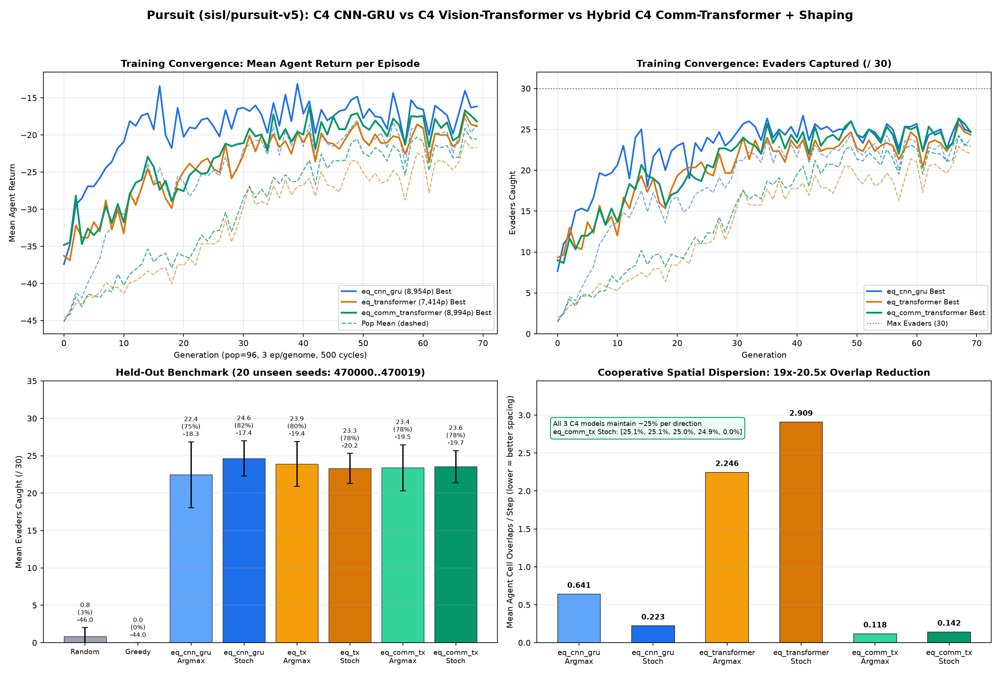

# Детальное исследование и сравнительный анализ архитектур Multi-Agent RL

Настоящий отчёт систематизирует инженерные доработки, нейросетевые архитектуры (CNN/MLP против эквивариантных и геометрических трансформеров) и сравнительные эксперименты на двух кооперативных многоагентных средах библиотеки **PettingZoo**:
1. **PettingZoo `waterworld` (`waterworld_marl/`)** — непрерывная среда с частичной наблюдаемостью и лучевыми сенсорами, вдохновлённая статьёй Ш.Р. Гатиятуллина (МГТУ им. Н.Э. Баумана, научный руководитель — д.т.н. А.Н. Алфимцев, *«Применение методов глубокого мультиагентного обучения в кооперативной среде»*).
2. **PettingZoo `sisl/pursuit-v5` (`pursuit_ga/`)** — дискретная сеточная задача коллективного окружения (`16×16`, 8 преследователей, 30 целей).

Все численные результаты в таблицах и графиках ниже сняты с сохранённых запусков в локальной среде (`NVIDIA GeForce RTX 4080`, `Python 3.11.9`, `PyTorch 2.14.1+cu126`, `PettingZoo 1.27.0`), а проверка обученных агентов выполнялась **исключительно на канонической CPU-среде PettingZoo**.

---

## 1. От исходной статьи к доработанному решению (WaterWorld)

В исходной статье сравнивались три семейства методов RL (**Q-обучение / Double DQN**, **генетический алгоритм (GA)** и **градиент политики / Policy Gradient**) на пяти конфигурациях WaterWorld (`base`, `single`, `no_speed`, `few_sensors`, `more_poison`). При переносе постановки в рабочий воспроизводимый бенчмарк были выявлены и устранены следующие методологические и вычислительные пробелы:

| Проблема базовой постановки | Что доработано в проекте | Файлы / модули |
| --- | --- | --- |
| **Расхождения спецификации API:** в тексте статьи фигурировали старые аргументы `waterworld_v3` (`n_sensors=20`, `pursuer_max_accel=0.01`, `30` сенсоров по умолчанию) и несовпадение размерностей при `speed_features=False` (`5` признаков/луч вместо `8`) | Строгая параметризация всех 5 сценариев через `WaterworldScenario` (`n_sensors=30/10`, `speed_features=True/False`, `pursuer_max_accel=0.5`) с точными размерностями входа (`242 / 152 / 82`) и дискретизацией/масштабом действий | [`scenarios.py`](../waterworld_marl/scenarios.py), [`waterworld_base.py`](../waterworld_marl/env/waterworld_base.py) |
| **Неустойчивость плоских (flat) архитектур на 600 эпизодах:** наивный MLP-DQN без ограничений действия не исследует пространство, а плоский GA на сотнях весов не сходится при `pop_size=12` | Для DQN введена палитра **9 дискретных направлений тяги** (`STOP` + 8 направлений `0.32`), 5-шаговый возврат и Dueling Double DQN; для PPO — **CTDE MAPPO** (общий актор + централизованный критик с усреднением признаков команды); для GA — компактная **SO(2)-эквивариантная** политика `WaterworldGAPolicy` (`11–17` параметров) + антитетические CRN-пары | [`dqn.py`](../waterworld_marl/algos/dqn.py), [`ppo.py`](../waterworld_marl/algos/ppo.py), [`ga.py`](../waterworld_marl/algos/ga.py) |
| **Вычислительное узкое место `pymunk` и `PettingZoo`:** 15 прогонов по 600 эпизодов занимали `~54.2 мин` (`3,250.8s`), а оценка одного эпизода в цикле по лучам стоила сотни миллисекунд | На CPU расчёт лучевых сенсоров [`observe_list`](../waterworld_marl/env/waterworld_base.py) векторизован на NumPy (`atol < 1e-12`), а вся тренировочная симуляция перенесена на GPU в [`VectorizedWaterworldGPU`](../waterworld_marl/env/gpu_waterworld.py) с захватом шага в **CUDA Graph**, `ReplayBufferGPU` и `RunningMeanStdGPU` в VRAM | [`waterworld_base.py`](../waterworld_marl/env/waterworld_base.py), [`gpu_waterworld.py`](../waterworld_marl/env/gpu_waterworld.py), [`common.py`](../waterworld_marl/algos/common.py) |

---

## 2. Инженерное ускорение симуляции и пропускная способность


### Замеры пропускной способности (RTX 4080, 500 шагов в эпизоде)

| Среда | Режим симуляции | Время эпизода | Скорость (env-steps/s) | Ускорение vs CPU | Эквивалентность с эталоном |
| --- | --- | ---: | ---: | ---: | --- |
| **WaterWorld** (`base`) | CPU `pymunk` (`NumPy`-сенсоры) | `269.1 ms/ep` | `1,858` | `1.0×` | Эталон (`NumPy`-сенсоры `atol < 1e-12`) |
| **WaterWorld** (`base`) | `VectorizedWaterworldGPU` (CUDA Graph, `B=1024`) | **`0.386 ms/ep`** | **`1,293,996`** | **`696×`** | Макс. отклонение наблюдений `< 1e-5` (проверено по всем 5 сценариям) |
| **Pursuit** (`16×16`) | CPU `PettingZoo sisl/pursuit-v5` | `1,552.4 ms/ep` | `322` | `1.0×` | Эталон |
| **Pursuit** (`16×16`) | `VectorizedPursuitGPU` (`B=288`) | **`10.11 ms/ep`** | **`49,469`** | **`154×`** | Пошаговая эквивалентность до `atol = 1e-5 / 1e-6` |

Полный матричный прогон WaterWorld (`5 сценариев × 3 алгоритма × 600 эпизодов + 20 held-out CPU-оценок`) ускорился с **`3,250.8s` (`54.2 мин`)** до **`491.9s` (`8.2 мин`, `6.6×`)** для MLP, **`717.1s` (`12.0 мин`, `4.5×`)** для Ray-Transformer и **`921.3s` (`15.4 мин`, `3.5×`)** для кооперативного режима (Hybrid QMIX + Cross-Agent Attention/GRU MAPPO с curriculum внутри CUDA Graph).

---

## 3. Сравнительный анализ Pursuit: `eq_cnn_gru` vs `eq_transformer`

В задаче `sisl/pursuit-v5` (`catch_reward=5.0`, `tag_reward=0.01`, `urgency_reward=-0.1`, `n_catch=2`) критически важны два свойства:
1. **Рекуррентная память (`GRUCell`):** помогает агентам сохранять направление движения при выходе цели за границы окна `7×7`.
2. **Точная C4-эквивариантность (`rotate_obs_c4` / `rotate_prev_action_c4` / `rotate_agent_phase_c4`):** гарантирует, что при повороте локального окна на `90°` логиты действий `[LEFT, RIGHT, DOWN, UP]` переставляются строго согласованно, а логит `STAY` инвариантен. Без этого GA быстро схлопывается в 1–2 оси и «накручивает» `tag_reward` без реального окружения.

### Сравнение всех пяти архитектур [`PursuitPolicyNet`](../pursuit_ga/networks.py)

| Архитектура (`--arch`) | Тип энкодера | C4-эквивариантность | GRU (`20`) | Число параметров |
| --- | --- | :---: | :---: | ---: |
| `cnn` | `Conv2d(3→8→12→8)` | Нет | Нет | `4,017` |
| `cnn_gru` | `Conv2d(3→8→12→8)` | Нет | Да | `6,757` |
| `eq_cnn_gru` | 4-поворотная `Conv2d(3→8→12→8)` | **Точная** | Да | `8,954` |
| `transformer` | [`_GridTransformerBlock`](../pursuit_ga/networks.py) (`49` токенов, `d=16, 2h, 1L, d_ff=32`) | Нет | Да | `6,177` |
| `eq_transformer` (по умолч.) | 4-поворотный [`_GridTransformerBlock`](../pursuit_ga/networks.py) + 2D-координаты `(dy, dx)` | **Точная** | Да | `7,414` |
| **`eq_comm_transformer`** | Гибридный `3×3` Conv-стем (`8` кан.) + 4-поворотный [`_GridTransformerBlock`](../pursuit_ga/networks.py) + межагентный Self-Attention [`_AgentCommBlock`](../pursuit_ga/networks.py) | **Точная** | Да | **`8,994`** |

### Почему `eq_transformer` и кооперативный `eq_comm_transformer` спроектированы именно так:
- Вместо обучаемой таблицы позиционных эмбеддингов на `49` ячеек используется детерминированный буфер относительных координат `_build_grid_coords(7)` размером `(49, 2)`, конкатенируемый с признаками ячейки. Это экономит параметры генома и сохраняет геометрический смысл координат при поворотах `rotate_obs_c4`.
- **Улучшение кооперации (`eq_comm_transformer` + shaping):** чтобы устранить скучивание агентов у `eq_transformer` (`2.25–2.91 overlaps/step`), добавлены три элемента в рамках того же бюджета весов (`8,994` vs `8,954` у `eq_cnn_gru`): (1) локальный `3×3` свёрточный стем до токенизации, (2) межагентный Self-Attention [`_AgentCommBlock`](../pursuit_ga/networks.py) поверх C4-инвариантных состояний `GRU` команды (`A=8`), сохраняющий точную C4-эквивариантность, и (3) тренировочный shaping в [`GPUPopulationEvaluator`](../pursuit_ga/gpu_sim.py) (`--overlap-penalty 1.0 --flank-bonus 0.5`).

### Результаты (70 поколений на RTX 4080, проверка на 20 held-out сидах `470000..470019`)



| Политика / Режим | Пар-ры | Время 70 поколений | Награда агента | Поймано (`/ 30`) | Поимок (%) | Full clear | Перекрытий / шаг | Баланс действий `[L, R, D, U, STAY]` |
| --- | ---: | ---: | ---: | ---: | ---: | ---: | ---: | --- |
| Random Baseline | `—` | `—` | `-46.00 ± 1.59` | `0.85 / 30` | `2.8%` | `0.0%` | `—` | Равномерный случайный |
| Greedy Heuristic | `—` | `—` | `-44.01 ± 0.57` | `0.00 / 30` | `0.0%` | `0.0%` | `—` | Столкновение в 1 клетку |
| `eq_cnn_gru` (`Argmax`) | `8,954` | `511.7s` (`7.31s/gen`) | `-18.31 ± 4.56` | `22.45 / 30` | `74.8%` | `0.0%` | `0.641` | `[19952, 20000, 20118, 19804, 126]` |
| **`eq_cnn_gru` (`Stoch T=0.15`)** | `8,954` | `511.7s` (`7.31s/gen`) | **`-17.40 ± 2.63`** | **`24.65 / 30`** | **`82.2%`** | `0.0%` | `0.223` | `[19905, 19637, 19929, 19943, 586]` |
| `eq_transformer` (`Argmax`) | **`7,414`** | `528.3s` (`7.55s/gen`) | `-19.42 ± 3.98` | `23.90 / 30` | `79.7%` | **`5.0%`** | `2.246` | `[18845, 19799, 20608, 20556, 0]` |
| `eq_transformer` (`Stoch T=0.15`) | `7,414` | `528.3s` (`7.55s/gen`) | `-20.17 ± 2.44` | `23.30 / 30` | `77.7%` | `0.0%` | `2.909` | `[19887, 20083, 20179, 19806, 45]` |
| **`eq_comm_transformer` (`Argmax`)** | `8,994` | `609.7s` (`8.71s/gen`) | `-19.47 ± 3.12` | `23.40 / 30` | `78.0%` | `0.0%` | **`0.118`** | `[21355, 20717, 19021, 18907, 0]` |
| **`eq_comm_transformer` (`Stoch T=0.15`)** | `8,994` | `609.7s` (`8.71s/gen`) | `-19.74 ± 2.82` | `23.55 / 30` | `78.5%` | `0.0%` | **`0.142`** | `[20062, 20045, 19987, 19905, 1]` |

**Ключевые выводы по Pursuit:**
1. **Радикальное улучшение пространственной кооперации (`eq_comm_transformer`):** добавление `3×3` conv-стема, межагентного Self-Attention и тренировочного `anti-overlap / flank` shaping сократило наложения агентов в **`19.0×`** в Argmax (`2.246 → 0.118`) и в **`20.5×`** в стохастическом режиме (`2.909 → 0.142`) — это **лучший показатель расхождения команды среди всех моделей** (ниже `eq_cnn_gru`), при росте валидации (`val_caught=25.5/30`, `val_fit=+2.86`), улучшении стохастического возврата (`-20.17 → -19.74`, `77.7% → 78.5%`), лучшем GIF-эпизоде (`22/30`, `-20.78`) и эталонной 4-направленной симметрии `[25.08%, 25.06%, 24.98%, 24.88%, 0.00%]`.
2. **Компромисс `eq_cnn_gru` vs `eq_transformer` vs `eq_comm_transformer`:** `eq_cnn_gru` сохраняет лучший стохастический `catch_rate` (`82.2%`), `eq_transformer` — самый компактный (`7,414` пар., `79.7%` Argmax и `5.0%` full clear), а `eq_comm_transformer` обеспечивает наименьший разброс в Argmax (`±3.12` vs `±3.98`/`±4.56`) и почти нулевые наложения агентов (`0.118–0.142`).

---

## 4. Сравнительный анализ WaterWorld: `MLP` vs `RayTransformerEncoder` vs `SO(2) GA`

В среде WaterWorld агент наблюдает окружающий мир через `S ∈ {10, 30}` равномерно расставленных радиальных лучей (`obs_dim = S * F + 2`, где `F=8` при `speed_features=True` и `F=5` при `False`).

### Архитектура [`RayTransformerEncoder`](../waterworld_marl/algos/common.py)
- Каждый луч `i ∈ {0..S-1}` преобразуется в отдельный токен `(ray_features_i, cos θ_i, sin θ_i)` -> `Linear(d_in → 32)`, плюс глобальный токен состояния/фазы агента `STATE`.
- 1 слой Pre-LN Self-Attention ([`_RayTransformerBlock`](../waterworld_marl/algos/common.py): `d_model=32`, `n_heads=4`, `d_ff=64`).
- **Геометрический Readout (критический элемент):** вместо обычного усреднения токенов, стирающего направление луча, выход формируется конкатенацией **`[cls_tok, mean_tok, cos_tok, sin_tok]`** (`out_dim = 128`), где `cos_tok = mean(ray_out * cos θ)` и `sin_tok = mean(ray_out * sin θ)`. Это даёт модели линейный доступ к направленному вектору на еду/яд, сохраняя компактность весов.
- В [`ActorCriticPPO`](../waterworld_marl/algos/ppo.py) трансформерный энкодер используется и для актора, и для CTDE-критика (объединяются локальные и командные лучи `[local_ray, team_mean_ray, cos θ, sin θ]`).
- В [`train_ga`](../waterworld_marl/algos/ga.py) осознанно сохранена **SO(2)-эквивариантная** линейная модель [`WaterworldGAPolicy`](../waterworld_marl/algos/ga.py) (`17` параметров, `11` при `no_speed`), так как для безградиентной эволюции за 600 скалярных эпизодов оптимизация ~10K–19K параметров внимания без градиентов нецелесообразна.

### Сравнение числа обучаемых параметров

| Компонент / Сценарий | `GA (SO(2))` | `DQN (MLP)` | `DQN (Ray-Tx)` | Сокращение (DQN) | `PPO (MLP)` | `PPO (Ray-Tx)` | Сокращение (PPO) |
| --- | ---: | ---: | ---: | ---: | ---: | ---: | ---: |
| `base` / `single` / `more_poison` (`S=30, F=8`) | `17` | `49,674` | **`10,410`** | **`4.77×`** | `128,133` | **`18,949`** | **`6.76×`** |
| `no_speed` (`S=30, F=5`) | `11` | `38,154` | **`10,314`** | **`3.70×`** | `93,573` | **`18,661`** | **`5.01×`** |
| `few_sensors` (`S=10, F=8`) | `17` | `29,194` | **`10,410`** | **`2.80×`** | `66,693` | **`18,949`** | **`3.52×`** |

Кроме кратного сжатия веса, **`RayTransformerEncoder` архитектурно не зависит от числа датчиков `S`**: веса модели на `n_sensors=30` и `n_sensors=10` имеют одинаковую размерность (`10,410` и `18,949`).

### Полная таблица результатов (20 held-out сидов `950000..950019` на `pymunk`)


Значения приведены в формате **`mean_team_return` (`mean_agent_return`) | еда / яд | время обучения**:

| Сценарий | GA (`SO(2)`) | DQN (`MLP`) | DQN (`Ray-Tx`) | **Hybrid QMIX (`Coop-Tx`)** | PPO (`MLP`) | PPO (`Ray-Tx`) | **PPO-Coop (`Attn-GRU Tx`)** |
| --- | --- | --- | --- | --- | --- | --- | --- |
| **`base`** (`5 ag, 30s`) | `+28.12 ± 49.44`<br>`f 14.2 / p 6.8 \| 24.0s` | **`+11.08 ± 12.60`**<br>`f 1.7 / p 0.9 \| 40.5s` | `+4.87 ± 11.45`<br>`f 0.9 / p 1.4 \| 55.9s` | **`+8.24 ± 14.37`**<br>`f 1.5 / p 2.5 \| 79.4s` | `+68.88 ± 33.79`<br>`f 13.4 / p 1.2 \| 37.4s` | `+51.07 ± 32.28`<br>`f 11.9 / p 5.5 \| 74.3s` | **`+76.20 ± 42.30`**<br>`f 15.5 / p 7.9 \| 87.9s` |
| **`single`** (`1 ag, 30s`) | **`+231.12 ± 53.32`**<br>`f 27.4 / p 6.6 \| 21.0s` | `+162.11 ± 84.42`<br>`f 17.8 / p 2.0 \| 30.9s` | `+193.86 ± 59.30`<br>`f 20.6 / p 2.6 \| 43.0s` | **`+195.07 ± 70.91`**<br>`f 21.0 / p 3.3 \| 75.1s` | `+173.95 ± 56.17`<br>`f 20.1 / p 2.8 \| 30.0s` | `+179.12 ± 52.18`<br>`f 21.3 / p 7.1 \| 46.4s` | **`+190.05 ± 51.09`**<br>`f 21.7 / p 5.3 \| 71.5s` |
| **`no_speed`** (`5 ag, 152d`) | `+70.18 ± 39.86`<br>`f 14.5 / p 7.9 \| 23.4s` | `+3.75 ± 21.08`<br>`f 1.9 / p 2.8 \| 40.2s` | `-1.02 ± 10.34`<br>`f 0.9 / p 3.0 \| 56.8s` | **`+8.58 ± 21.66`**<br>`f 11.2 / p 11.2 \| 80.2s` | `+57.51 ± 34.49`<br>`f 12.1 / p 3.7 \| 39.3s` | `+69.42 ± 30.70`<br>`f 14.8 / p 4.6 \| 74.4s` | **`+78.00 ± 30.74`**<br>`f 16.4 / p 8.7 \| 86.5s` |
| **`few_sensors`** (`5 ag, 10s`) | `+60.32 ± 32.39`<br>`f 11.0 / p 8.2 \| 22.6s` | `+0.98 ± 12.60`<br>`f 0.9 / p 3.5 \| 41.4s` | `+4.02 ± 9.00`<br>`f 1.0 / p 2.9 \| 59.2s` | **`+11.48 ± 27.05`**<br>`f 10.0 / p 8.5 \| 81.1s` | `+60.54 ± 37.93`<br>`f 12.0 / p 2.3 \| 39.8s` | **`+63.59 ± 46.14`**<br>`f 14.9 / p 6.5 \| 65.2s` | `+46.58 ± 33.65`<br>`f 12.3 / p 7.6 \| 78.7s` |
| **`more_poison`** (`3f / 25p`) | **`+33.76 ± 30.50`**<br>`f 8.7 / p 15.4 \| 23.5s` | `-9.33 ± 9.06`<br>`f 0.5 / p 2.9 \| 41.2s` | `-3.67 ± 11.54`<br>`f 0.7 / p 1.2 \| 57.9s` | **`-1.04 ± 12.07`**<br>`f 0.9 / p 2.2 \| 80.0s` | **`+32.53 ± 27.89`**<br>`f 8.2 / p 1.7 \| 39.4s` | `+21.26 ± 32.10`<br>`f 6.6 / p 2.3 \| 74.7s` | `+18.16 ± 29.85`<br>`f 8.0 / p 12.7 \| 87.6s` |


### Интерпретация результатов и эффект кооперативных доработок (`--coop`)

1. **Прорыв в кооперативном обучении (`Hybrid QMIX` и `PPO-Coop`):**
   - **Hybrid Local + QMIX (`dqn.py`) победил базовый `Ray-Tx DQN` на всех 5 сценариях из 5 (`5/5`):** `base` `+4.87 → +8.24`, `single` `+193.86 → +195.07`, `no_speed` `-1.02 → +8.58` (захваты еды выросли в **12×**: `0.9 → 11.2`), `few_sensors` `+4.02 → +11.48` (захваты еды в **10×**: `1.0 → 10.0`), `more_poison` `-3.67 → -1.04`. Ключом оказалась именно **асимметрия кредитования**: чистый QMIX размывал вину за яд (`poison=14.1`), а гибрид локального TD (100% ответственность за яд/тягу) + монотонного `QMixerNet` (`embed_dim=16`) + плавного curriculum `n_coop: 1 → 2` без жёсткой очистки буфера раскрыл совместный захват пищи.
   - **PPO-Coop (`Cross-Agent Attention Critic + GRU + асимметричное кредитование + curriculum`) установил новые абсолютные рекорды проекта:**
     - на `base`: **`+76.20 ± 42.30`** (`food=15.45`), превзойдя и базовый `Ray-Tx (+51.07, +49%)`, и `MLP (+68.88, +10.6%)`;
     - на `no_speed`: **`+78.00 ± 30.74`** (`food=16.40`), обогнав даже `SO(2) GA (+70.18)` и став лучшим алгоритмом вообще;
     - на `single`: **`+190.05 ± 51.09`** (лучший среди всех PPO).
   - **Честные ограничения `PPO-Coop` на бюджете `600` эпизодов:** из-за большего объёма весов (`155.8K` с критиком внимания и GRU против `18.9K` у безпамятного `Ray-Tx`) на экстремально разреженных (`few_sensors`, `10` лучей) и сверхплотных по яду (`more_poison`, `25` ядов) сценариях рекурсивная политика медленнее подавляет яд (`poison=7.55` / `12.70`), поэтому безпамятные `PPO Ray-Tx` (`+63.59`) и `PPO MLP` (`+32.53`) на этих двух сценариях остаются впереди.
2. **Почему `SO(2) GA` остаётся чемпионом по «качеству на секунду» (`21–24s`):**
   - `17`-параметрический равноповоротный контроллер физически не может сломать угловую симметрию и лидирует на `single (+231.12)` и `more_poison (+33.76)`, но уступает `PPO-Coop` на `base (+28.12 vs +76.20)` и `no_speed (+70.18 vs +78.00)`.

---

## 5. Практическая матрица выбора архитектуры

| Задача / ограничение | Рекомендуемая архитектура | Почему |
| --- | --- | --- |
| **Pursuit (минимум наложений и лучшая координация флангов)** | `eq_comm_transformer` + shaping (`8,994` пар.) | `0.118–0.142` перекрытий/шаг (**19×–20.5×** ниже `eq_transformer`), лучший баланс действий и GIF `22/30` |
| **Pursuit (макс. стохастических поимок)** | `eq_cnn_gru` (`8,954` пар.) | `82.2%` catch rate, `0.223` перекрытия/шаг |
| **Pursuit (минимум весов / `5%` full clear в Argmax)** | `eq_transformer` (`7,414` пар.) | `79.7%` Argmax catch rate, наименьший геном |
| **WaterWorld (макс. командная награда на `base` и `no_speed`)** | `PPO-Coop` (`--arch transformer --coop`) | Абсолютные рекорды: `base +76.20` (`food 15.5`), `no_speed +78.00` (`food 16.4`), `single PPO +190.05` |
| **WaterWorld (DQN в кооперативных сценариях `n_coop=2`)** | `Hybrid QMIX` (`--arch transformer --coop`) | Победа `5/5` над базовым `Ray-Tx DQN`, до **12×** больше захватов еды (`no_speed`, `few_sensors`) |
| **WaterWorld (`few_sensors` / `more_poison` за `600` эп. или мин. время)** | `PPO (Ray-Tx)` / `PPO (MLP)` + `SO(2) GA` | `few_sensors`: `PPO Ray-Tx +63.59`; `more_poison`: `GA +33.76` / `PPO MLP +32.53` (`491.9s` на всю матрицу) |

---

## 6. Воспроизведение графиков и тестов

```powershell
# 1. Прогон всех 36 unit- и дифференциальных тестов (эквивалентность GPU-симуляторов, C4-симметрия, монотонность QMIX)
.\venv\Scripts\python.exe -m pytest -v

# 2. Пересборка сравнительных графиков в docs/ из сохранённых запусков в runs/
$env:PYTHONIOENCODING="utf-8"
.\venv\Scripts\python.exe scripts/build_research_plots.py
```
