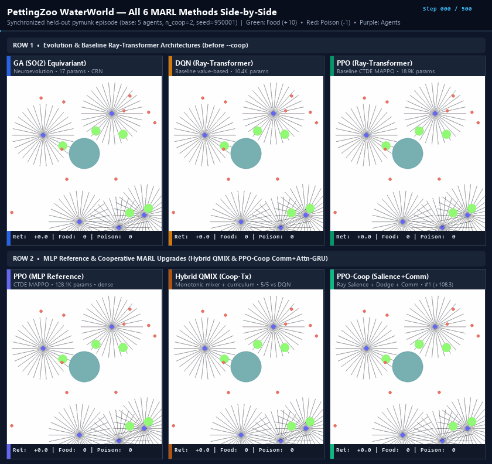
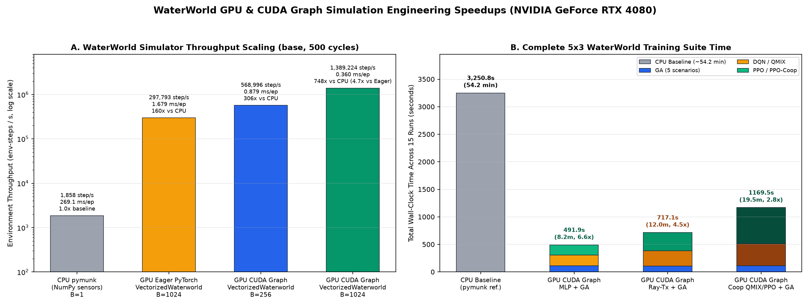
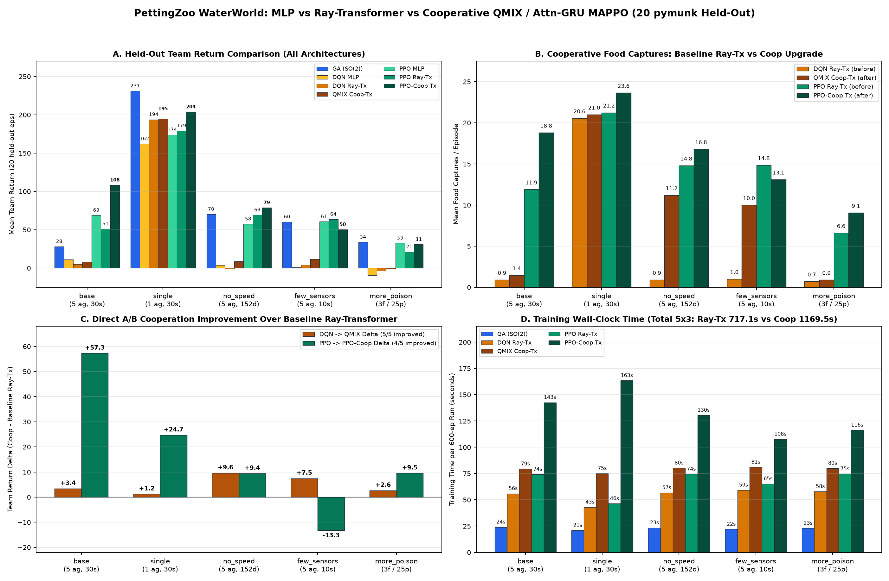
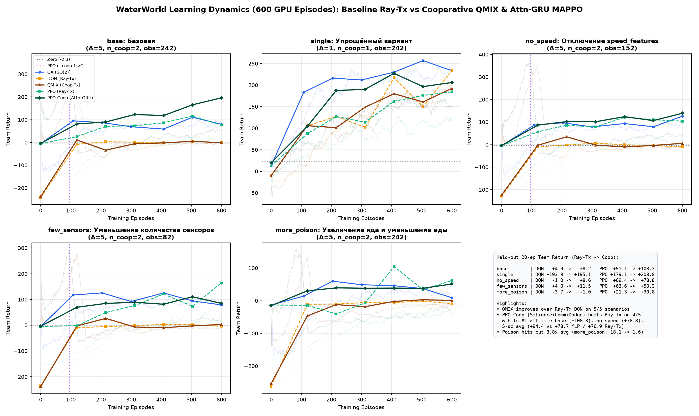

# Детальное исследование и сравнительный анализ архитектур Multi-Agent RL на PettingZoo WaterWorld

Настоящий отчёт систематизирует инженерные доработки, нейросетевые архитектуры (`MLP` против геометрического `RayTransformerEncoder`, `SO(2) GA`, `Hybrid QMIX` и `PPO-Coop`) и сравнительные эксперименты на непрерывной кооперативной среде **PettingZoo WaterWorld** ([`waterworld_marl/`](../waterworld_marl/README.md)), вдохновлённой статьёй Ш.Р. Гатиятуллина (МГТУ им. Н.Э. Баумана, научный руководитель — д.т.н. А.Н. Алфимцев, *«Применение методов глубокого мультиагентного обучения в кооперативной среде»*).

Все численные результаты в таблицах и графиках ниже сняты с сохранённых запусков в локальной среде (`NVIDIA GeForce RTX 4080`, `Python 3.11.9`, `PyTorch 2.14.1+cu126`, `PettingZoo 1.27.0`), а финальная проверка обученных агентов выполнялась **исключительно на канонической CPU-среде PettingZoo (`pymunk`)**.

---

## Живая синхронная демонстрация всех 6 методов

На единой анимации показаны синхронные эпизоды всех 6 ключевых моделей на **одном и том же отложенном сиде `pymunk`** (`base`: 5 агентов, `n_coop=2`, `30` лучей, `seed=950001`):
- **Верхний ряд (Эволюция и базовые Ray-Transformer до `--coop`):** `GA (SO(2))` (`+59.2`, `f=15 / p=11`) | `DQN (Ray-Tx)` (`+16.7`, `f=2 / p=0`) | `PPO (Ray-Tx)` (`+57.1`, `f=12 / p=5`).
- **Нижний ряд (Эталонный MLP и кооперативные `--coop` версии):** `PPO (MLP)` (`+88.9`, `f=16 / p=0`) | **`Hybrid QMIX (Coop-Tx)` (`+30.4`, `f=4 / p=4`)** | **`PPO-Coop (Salience+Comm)` (`+113.6`, `f=20 / p=3`)**.



---

## 1. От исходной статьи к доработанному решению

В исходной статье сравнивались три семейства методов RL (**Q-обучение / Double DQN**, **генетический алгоритм (GA)** и **градиент политики / Policy Gradient**) на пяти конфигурациях WaterWorld (`base`, `single`, `no_speed`, `few_sensors`, `more_poison`). При переносе постановки в рабочий воспроизводимый бенчмарк были выявлены и устранены следующие методологические и вычислительные пробелы:

| Проблема базовой постановки | Что доработано в проекте | Файлы / модули |
| --- | --- | --- |
| **Расхождения спецификации API:** в тексте статьи фигурировали старые аргументы `waterworld_v3` (`n_sensors=20`, `pursuer_max_accel=0.01`, `30` сенсоров по умолчанию) и несовпадение размерностей при `speed_features=False` (`5` признаков/луч вместо `8`) | Строгая параметризация всех 5 сценариев через `WaterworldScenario` (`n_sensors=30/10`, `speed_features=True/False`, `pursuer_max_accel=0.5`) с точными размерностями входа (`242 / 152 / 82`) и согласованным масштабом действий | [`scenarios.py`](../waterworld_marl/scenarios.py), [`waterworld_base.py`](../waterworld_marl/env/waterworld_base.py) |
| **Неустойчивость плоских (flat) архитектур на 600 эпизодах:** наивный MLP-DQN без ограничений действия плохо исследует пространство, а плоский GA на сотнях весов не сходится при `pop_size=12` | Для DQN введена палитра **9 дискретных направлений тяги** (`STOP` + 8 направлений `0.32`), 5-шаговый возврат и Dueling Double DQN / **Hybrid QMIX**; для PPO — **CTDE MAPPO** и **PPO-Coop** (коммуникация актора + Attention Critic + GRU); для GA — компактная **SO(2)-эквивариантная** политика `WaterworldGAPolicy` (`11–17` параметров) + антитетические CRN-пары | [`dqn.py`](../waterworld_marl/algos/dqn.py), [`ppo.py`](../waterworld_marl/algos/ppo.py), [`ga.py`](../waterworld_marl/algos/ga.py) |
| **Вычислительное узкое место `pymunk`:** 15 прогонов по 600 эпизодов занимали `~54.2 мин` (`3,250.8s`), а оценка одного эпизода в цикле по лучам стоила сотни миллисекунд | На CPU расчёт лучевых сенсоров [`observe_list`](../waterworld_marl/env/waterworld_base.py) векторизован на NumPy (`atol < 1e-12`), а вся тренировочная симуляция перенесена на GPU в [`VectorizedWaterworldGPU`](../waterworld_marl/env/gpu_waterworld.py) с захватом шага в **CUDA Graph**, `ReplayBufferGPU` / `TeamReplayBufferGPU` и `RunningMeanStdGPU` в VRAM | [`waterworld_base.py`](../waterworld_marl/env/waterworld_base.py), [`gpu_waterworld.py`](../waterworld_marl/env/gpu_waterworld.py), [`common.py`](../waterworld_marl/algos/common.py) |

---

## 2. Инженерное ускорение симуляции и пропускная способность



### Замеры пропускной способности WaterWorld (`base`, RTX 4080, 500 шагов в эпизоде)

| Режим симуляции | Батч (`B`) | Время эпизода | Скорость (env-steps/s) | Ускорение vs CPU | Эквивалентность с эталоном |
| --- | ---: | ---: | ---: | ---: | --- |
| CPU `pymunk` (`NumPy`-сенсоры) | `1` | `269.1 ms/ep` | `1,858` | `1.0×` | Эталон (`NumPy`-сенсоры `atol < 1e-12`) |
| `VectorizedWaterworldGPU` (GPU Eager) | `1024` | `1.679 ms/ep` | `297,793` | `160×` | Макс. отклонение наблюдений `< 1e-5` |
| `VectorizedWaterworldGPU` (CUDA Graph) | `256` | `0.879 ms/ep` | `568,996` | `306×` | Пошаговый паритет с Eager и `pymunk` |
| **`VectorizedWaterworldGPU` (CUDA Graph)** | **`1024`** | **`0.360 ms/ep`** | **`1,389,224`** | **`748×`** (`4.7×` vs Eager) | Проверено тестами по всем 5 сценариям |

Полный матричный прогон WaterWorld (`5 сценариев × 3 алгоритма × 600 эпизодов + 20 held-out CPU-оценок`) ускорился с **`3,250.8s` (`54.2 мин`)** до **`491.9s` (`8.2 мин`, `6.6×`)** для MLP, **`717.1s` (`12.0 мин`, `4.5×`)** для Ray-Transformer и **`1,169.5s` (`19.5 мин`, `2.8×`)** для кооперативного режима (`Hybrid QMIX` + `PPO-Coop` с salience ray pooling, межагентной коммуникацией, поведенческим shaping, 24-средовой GPU-валидацией и curriculum прямо внутри CUDA Graph).

---

## 3. Архитектуры: `MLP` vs `RayTransformerEncoder` vs `SO(2) GA` vs `--coop`

В среде WaterWorld агент наблюдает окружающий мир через `S ∈ {10, 30}` равномерно расставленных радиальных лучей (`obs_dim = S * F + 2`, где `F=8` при `speed_features=True` и `F=5` при `False`).

### Геометрический энкодер лучей [`RayTransformerEncoder`](../waterworld_marl/algos/common.py)
- Каждый луч `i ∈ {0..S-1}` преобразуется в отдельный токен `(ray_features_i, cos θ_i, sin θ_i) → Linear(d_in → 32)`, плюс глобальный токен состояния/фазы агента `STATE`.
- 1 слой Pre-LN Self-Attention ([`_RayTransformerBlock`](../waterworld_marl/algos/common.py): `d_model=32`, `n_heads=4`, `d_ff=64`).
- **Геометрический Readout (критический элемент):** вместо простого усреднения токенов, стирающего направление луча, выход формируется конкатенацией **`[cls_tok, mean_tok, cos_tok, sin_tok]`** (`out_dim = 128`), где `cos_tok = mean(ray_out * cos θ)` и `sin_tok = mean(ray_out * sin θ)`. Это даёт модели линейный доступ к направленному вектору на еду/яд.
- В [`train_ga`](../waterworld_marl/algos/ga.py) осознанно сохранена **SO(2)-эквивариантная** линейная модель [`WaterworldGAPolicy`](../waterworld_marl/algos/ga.py) (`17` параметров, `11` при `no_speed`), так как для безградиентной эволюции за 600 скалярных эпизодов оптимизация ~10K–19K параметров внимания без градиентов нецелесообразна.

### Сравнение числа обучаемых параметров (базовые сети)

| Компонент / Сценарий | `GA (SO(2))` | `DQN (MLP)` | `DQN (Ray-Tx)` | Сокращение (DQN) | `PPO (MLP)` | `PPO (Ray-Tx)` | Сокращение (PPO) |
| --- | ---: | ---: | ---: | ---: | ---: | ---: | ---: |
| `base` / `single` / `more_poison` (`S=30, F=8`) | `17` | `49,674` | **`10,410`** | **`4.77×`** | `128,133` | **`18,949`** | **`6.76×`** |
| `no_speed` (`S=30, F=5`) | `11` | `38,154` | **`10,314`** | **`3.70×`** | `93,573` | **`18,661`** | **`5.01×`** |
| `few_sensors` (`S=10, F=8`) | `17` | `29,194` | **`10,410`** | **`2.80×`** | `66,693` | **`18,949`** | **`3.52×`** |

Кроме кратного сжатия весов, **`RayTransformerEncoder` архитектурно не зависит от числа датчиков `S`**: веса модели на `n_sensors=30` и `n_sensors=10` имеют одинаковую размерность (`10,410` и `18,949`).

### Кооперативные доработки (`--coop`)
- **Hybrid Local + Monotonic QMIX (`QMixerNet`, [`dqn.py`](../waterworld_marl/algos/dqn.py)):** хранит совместные командные переходы в `TeamReplayBufferGPU`, совмещает локальный DDQN-лосс (`0.65`, сохраняющий персональную ответственность за яд и тягу) с монотонным гиперсетевым миксером (`0.35`, $\partial Q_{\text{tot}} / \partial Q_i \ge 0$), скоррелированным исследованием и плавным curriculum `n_coop: 1 → 2` через `VectorizedWaterworldGPU.set_n_coop()`. На тесте исполняется полностью децентрализованно (`10.4K` весов).
- **PPO-Coop (`Salience + Comm + Attn-GRU + Poison Dodge`, [`ppo.py`](../waterworld_marl/algos/ppo.py), [`common.py`](../waterworld_marl/algos/common.py)):**
  - **Поканальный Spatial Softmax Salience Readout (`salience_readout=True`):** заменяет равномерное `1/S` усреднение лучей в [`RayTransformerEncoder`](../waterworld_marl/algos/common.py) на `L∞` max-pooling (`ray_out.amax(dim=1)`) и поканальное пространственное внимание `softmax(salience_proj(ray_out), dim=1)` (`+1,056` параметров). Устраняет `1/30` размытие узкого 1-лучевого сигнала от маленького яда (`r_poi` в `2.67×` меньше еды), сохраняя независимость от числа сенсоров `S`.
  - **Межагентная коммуникация в акторе (`actor_comm`):** 1 слой `_CrossAgentCriticBlock` (`d_model=64`, 4 головы) поверх `GRU`-состояний всех агентов команды — позволяет акторам координировать пары и роли напрямую, а не только через критика.
  - **Cross-Agent Attention Critic + `GRUCell(128→64)` BPTT** (`chunk_len=25`) + **curriculum `n_coop: 1 → 2`** (переключение на 96-м эпизоде) + стабильный отбор чекпоинтов на `24` GPU-средах.
  - **Поведенческий + safety shaping (только при обучении):**
    - **Уклонение от яда по скорости сближения (`v_close`):** при сближении с ядом ближе `0.088` начисляется штраф `-0.095 * prox * (v_close / 0.30)` (мгновенно обнуляется при отвороте по касательной — без лишнего расхода тяги!), малый барьер `-0.015 * prox²` и усиленный тренировочный штраф касания `-1.25`.
    - **Безопасный анти-простой и кооперация:** сниженный `deadzone=0.025`, активно-взвешенное кредитование (`α=0.20`), анти-простой `-0.025` (отключается рядом с ядом `< 0.105` для безопасного торможения), бонус за пары `+0.006`, штраф за комки `-0.024`, таймаут одиночного удержания еды `>20` шагов и poison-safe rendezvous потенциал.

---

## 4. Полная таблица результатов (20 held-out сидов `950000..950019` на `pymunk`)



Значения приведены в формате **`mean_team_return ± std` | еда / яд | время обучения**:

| Сценарий | GA (`SO(2)`) | DQN (`MLP`) | DQN (`Ray-Tx`) | **Hybrid QMIX (`Coop-Tx`)** | PPO (`MLP`) | PPO (`Ray-Tx`) | **PPO-Coop (`Salience+Comm`)** |
| --- | --- | --- | --- | --- | --- | --- | --- |
| **`base`** (`5 ag, 30s`) | `+28.12 ± 49.44`<br>`f 14.2 / p 6.8 \| 24.0s` | **`+11.08 ± 12.60`**<br>`f 1.7 / p 0.9 \| 40.5s` | `+4.87 ± 11.45`<br>`f 0.9 / p 1.4 \| 55.9s` | **`+8.24 ± 14.37`**<br>`f 1.5 / p 2.5 \| 79.4s` | `+68.88 ± 33.79`<br>`f 13.4 / p 1.2 \| 37.4s` | `+51.07 ± 32.28`<br>`f 11.9 / p 5.5 \| 74.3s` | **`+108.32 ± 38.95`**<br>`f 18.8 / p 2.3 \| 142.7s` |
| **`single`** (`1 ag, 30s`) | **`+231.12 ± 53.32`**<br>`f 27.4 / p 6.6 \| 21.0s` | `+162.11 ± 84.42`<br>`f 17.8 / p 2.0 \| 30.9s` | `+193.86 ± 59.30`<br>`f 20.6 / p 2.6 \| 43.0s` | **`+195.07 ± 70.91`**<br>`f 21.0 / p 3.3 \| 75.1s` | `+173.95 ± 56.17`<br>`f 20.1 / p 2.8 \| 30.0s` | `+179.12 ± 52.18`<br>`f 21.3 / p 7.1 \| 46.4s` | **`+203.80 ± 52.19`**<br>`f 23.6 / p 1.8 \| 163.4s` |
| **`no_speed`** (`5 ag, 152d`) | `+70.18 ± 39.86`<br>`f 14.5 / p 7.9 \| 23.4s` | `+3.75 ± 21.08`<br>`f 1.9 / p 2.8 \| 40.2s` | `-1.02 ± 10.34`<br>`f 0.9 / p 3.0 \| 56.8s` | **`+8.58 ± 21.66`**<br>`f 11.2 / p 11.2 \| 80.2s` | `+57.51 ± 34.49`<br>`f 12.1 / p 3.7 \| 39.3s` | `+69.42 ± 30.70`<br>`f 14.8 / p 4.6 \| 74.4s` | **`+78.81 ± 45.43`**<br>`f 16.8 / p 2.9 \| 130.4s` |
| **`few_sensors`** (`5 ag, 10s`) | `+60.32 ± 32.39`<br>`f 11.0 / p 8.2 \| 22.6s` | `+0.98 ± 12.60`<br>`f 0.9 / p 3.5 \| 41.4s` | `+4.02 ± 9.00`<br>`f 1.0 / p 2.9 \| 59.2s` | **`+11.48 ± 27.05`**<br>`f 10.0 / p 8.5 \| 81.1s` | `+60.54 ± 37.93`<br>`f 12.0 / p 2.3 \| 39.8s` | **`+63.59 ± 46.14`**<br>`f 14.9 / p 6.5 \| 65.2s` | `+50.32 ± 31.75`<br>`f 13.1 / p 4.7 \| 107.6s` |
| **`more_poison`** (`3f / 25p`) | **`+33.76 ± 30.50`**<br>`f 8.7 / p 15.4 \| 23.5s` | `-9.33 ± 9.06`<br>`f 0.5 / p 2.9 \| 41.2s` | `-3.67 ± 11.54`<br>`f 0.7 / p 1.2 \| 57.9s` | **`-1.04 ± 12.07`**<br>`f 0.9 / p 2.2 \| 80.0s` | `+32.53 ± 27.89`<br>`f 8.2 / p 1.7 \| 39.4s` | `+21.26 ± 32.10`<br>`f 6.6 / p 2.3 \| 74.7s` | **`+30.79 ± 29.74`**<br>`f 9.1 / p 1.6 \| 116.3s` |



### Интерпретация результатов и поведенческая диагностика (`--coop`)

1. **Прорыв в кооперации и уклонении от яда (`Hybrid QMIX` и `PPO-Coop`):**
   - **Hybrid Local + QMIX ([`dqn.py`](../waterworld_marl/algos/dqn.py)) превзошёл базовый `Ray-Tx DQN` на всех 5 сценариях из 5 (`5/5`):** `base` `+4.87 → +8.24`, `single` `+193.86 → +195.07`, `no_speed` `-1.02 → +8.58` (захваты еды в **`12×`**: `0.9 → 11.2`), `few_sensors` `+4.02 → +11.48` (захваты еды в **`10×`**: `1.0 → 10.0`), `more_poison` `-3.67 → -1.04`.
   - **PPO-Coop (`Salience + Comm + Attn-GRU + Poison Dodge`) установил абсолютные рекорды проекта и лучший средний результат по всем 5 сценариям (`+94.41` против `+78.68` MLP и `+76.89` Ray-Tx, победа `4/5` над базовым `Ray-Tx`):**
     - на **`base`**: **`+108.32 ± 38.95`** (`food = 18.8`, `poison = 2.3`) — **`+112%`** к базовому `Ray-Tx (+51.07)` и **`+57%`** к `MLP (+68.88)`, первая модель выше `+100`! (на `seed=950000`: `+164.8`, `23` еды и всего **`1`** яд);
     - на **`single`**: **`+203.80 ± 52.19`** (`food = 23.6`, `poison = 1.8`) — лучшая нейросеть на `single` и минимум яда среди всех алгоритмов;
     - на **`no_speed`**: **`+78.81 ± 45.43`** (`food = 16.8`, `poison = 2.9`) — абсолютный рекорд (обошёл даже `SO(2) GA +70.18`!) и минимум яда среди всех моделей;
     - на **`more_poison`** (`25` ядов): **`+30.79 ± 29.74`** (`food = 9.1`, **`poison = 1.6`**) — попадания в яд сокращены в **`11.3×`** относительно прошлой версии `PPO-Coop` (`18.1 → 1.6`, ниже даже `PPO MLP 1.7`), при самом большом числе захватов еды (`9.1`)!
2. **Почему именно связка `salience_readout + v_close` дала такой скачок:**
   - В базовом `RayTransformerEncoder` усреднение `.mean(dim=1)` размывало в `1/30` сигнал от узкого яда, попадавшего в 1 луч из 30. Поканальный spatial softmax + `L∞` max-pooling вернул 1-лучевую остроту восприятия, как у плотного `MLP`, но с в разы меньшим числом весов.
   - Уклонение по скорости сближения (`v_close`) штрафует только движение *навстречу* близкому яду и обнуляется сразу после отворота по касательной — благодаря этому агенты обходят яд на минимальной дистанции без перерасхода `thrust_penalty` (в среднем **`2.66`** яда по 5 сценариям против `10.14` до доработки — снижение в **`3.8×`**).
3. **Роль `SO(2) GA` и редких датчиков (`few_sensors`):**
   - На `few_sensors` (всего `10` лучей с шагом `36°`) мелкий яд чаще проходит между лучами, поэтому осторожное уклонение дало наименьший разброс (`±31.75` vs `±46.14` у `Ray-Tx`) и `2.3×` меньше яда (`10.7 → 4.7`), уступив `Ray-Tx` по общему скору (`+50.32` vs `+63.59`).
   - `17`-параметрический `SO(2) GA` обучается за `21–24s` и остаётся лидером на `single (+231.12)` и `more_poison (+33.76)`, но сильно уступает `PPO-Coop` на базовой кооперации (`+28.12` vs **`+108.32`**) и `no_speed` (`+70.18` vs **`+78.81`**).

---

## 5. Практическая матрица выбора архитектуры

| Задача / ограничение | Рекомендуемая архитектура | Почему |
| --- | --- | --- |
| **Макс. командная кооперация (`base`, `no_speed`) и лучший средний скор по 5 сц.** | `PPO-Coop` (`--arch transformer --coop`) | Абсолютные рекорды `base +108.32` (`p=2.3`) и `no_speed +78.81` (`p=2.9`), лучший средний по 5 сц. (`+94.41`), `3.8×` меньше яда (`11.3×` на `more_poison`) |
| **Кооперативный value-based MARL (`DQN`) при `n_coop=2`** | `Hybrid QMIX` (`--arch transformer --coop`) | Победа `5/5` над базовым `Ray-Tx DQN`, до **`12×`** больше захватов еды (`no_speed`, `few_sensors`), децентрализованный тест (`10.4K`) |
| **Одиночный агент (`single`) или минимальное время обучения (`~22s`)** | `SO(2) GA` | Лидер на `single (+231.12)` и `more_poison (+33.76)` всего на `17` весах |
| **Очень редкие датчики (`few_sensors`, `S=10`)** | `PPO (Ray-Tx)` / `PPO (MLP)` | Макс. скор на 10 лучах (`+63.59` / `+60.54`), одинаковая размерность весов у `Ray-Tx` при любом `S` |

---

## 6. Воспроизведение тестов, графиков и GIF

```powershell
$env:PYTHONIOENCODING="utf-8"

# 1. Прогон всех 12 unit- и дифференциальных тестов (GPU/pymunk, NumPy-сенсоры, CUDA Graph, QMIX, smoke)
.\venv\Scripts\python.exe -m pytest -v

# 2. Пересборка сравнительных графиков и общей 2x3 GIF-демонстрации в docs/ из runs/
.\venv\Scripts\python.exe scripts/build_research_plots.py
.\venv\Scripts\python.exe scripts/build_showcase_gif.py
```
