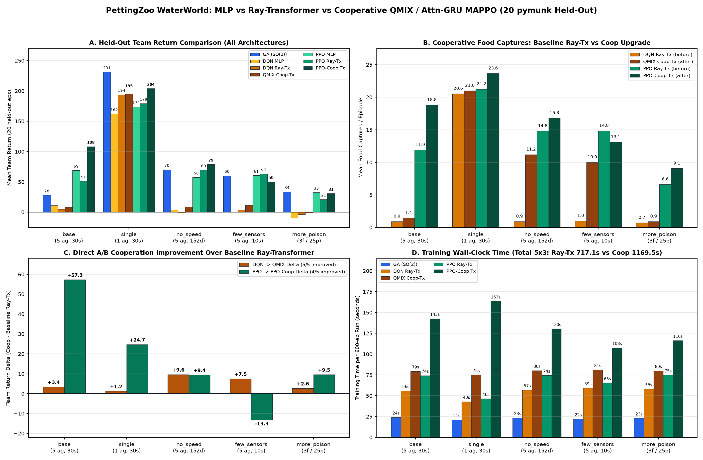
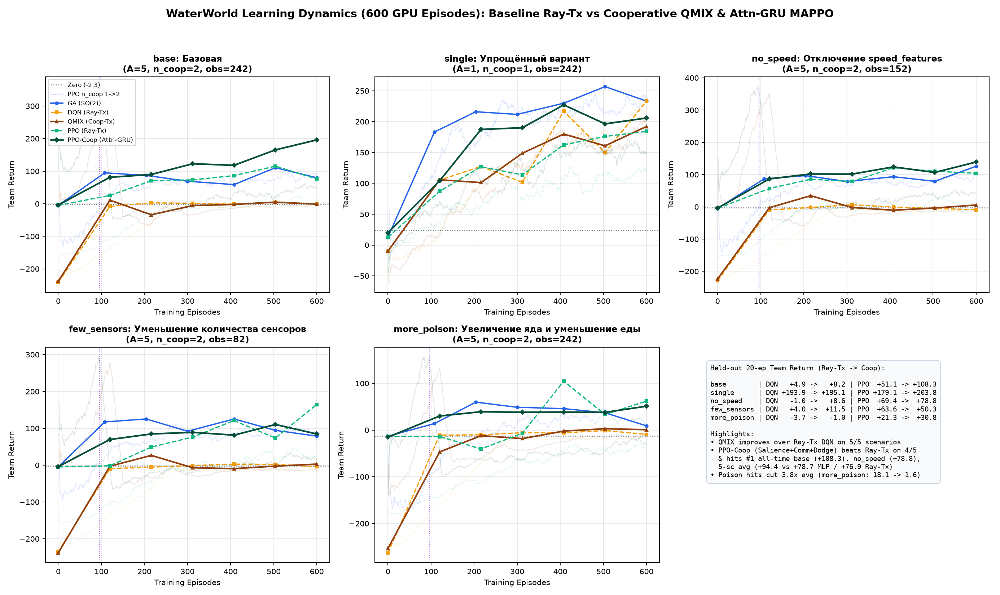

# WaterWorld MARL Benchmark (PettingZoo)

Воспроизведение, методическая доработка и архитектурное расширение экспериментов статьи МГТУ им. Н.Э. Баумана (Ш.Р. Гатиятуллин, науч. рук. д.т.н. А.Н. Алфимцев, *«Применение методов глубокого мультиагентного обучения в кооперативной среде»*) на непрерывной кооперативной среде PettingZoo **WaterWorld** ([`env/waterworld_base.py`](env/waterworld_base.py)) с полным переносом симуляции на GPU (CUDA Graph) и сравнением **`MLP`**, геометрического **`RayTransformerEncoder`** и **SO(2)-эквивариантной эволюции**.

> Полный сравнительный анализ, разбор расхождений с исходной статьёй и графики обучения: [`docs/RESEARCH_REPORT.md`](../docs/RESEARCH_REPORT.md).

## Сценарии ([`scenarios.py`](scenarios.py))

| Ключ | Название из статьи | Ключевые отличия от базы | Размер obs |
| --- | --- | --- | ---: |
| `base` | Базовая | `n_pursuers=5, n_coop=2, n_evaders=5, n_poisons=10, n_sensors=30, speed_features=True` | `242` |
| `single` | Упрощённый вариант | `n_pursuers=1, n_coop=1` | `242` |
| `no_speed` | Отключение `speed_features` | `speed_features=False` (`5` признаков на луч вместо `8`) | `152` |
| `few_sensors` | Уменьшение количества сенсоров | `n_sensors=10` | `82` |
| `more_poison` | Увеличение яда и уменьшение еды | `n_evaders=3, n_poisons=25` | `242` |

## Ускорение и архитектуры ([`env/`](env/) и [`algos/`](algos/))

- **GPU-симулятор и векторизация сенсоров ([`env/gpu_waterworld.py`](env/gpu_waterworld.py), [`env/waterworld_base.py`](env/waterworld_base.py)):**
  - [`VectorizedWaterworldGPU`](env/gpu_waterworld.py): батчевый PyTorch CUDA-симулятор физики, барьеров/центрального препятствия, кооперативного захвата еды и лучевых датчиков с захватом шага в **CUDA Graph** (**`1,389,224 env-steps/s`** / `0.360 ms/ep` при `B=1024` на RTX 4080 против `1,858 env-steps/s` / `269.1 ms/ep` на `pymunk` CPU — **`748×`**, и `4.7×` против GPU Eager; отклонение наблюдений `< 1e-5`).
  - В [`env/waterworld_base.py`](env/waterworld_base.py) расчёт лучевых сенсоров [`observe_list`](env/waterworld_base.py) векторизован на NumPy (`atol < 1e-12`).
  - Итоговое время всей матрицы `5×3` (`600` эп. × `15` запусков) снизилось с `3,250.8s` (`~54.2 мин`) до **`491.9s` (`8.2 мин`, `6.6×`)** для `MLP` и **`717.1s` (`12.0 мин`, `4.5×`)** для `Ray-Transformer`, при финальной проверке (`20` held-out сидов `950000..950019`) и рендере GIF на оригинальном `pymunk`.
- **Геометрический энкодер лучей ([`algos/common.py`](algos/common.py)) — `RayTransformerEncoder` (`--arch transformer`, по умолчанию):**
  - Представляет каждый луч лидара токеном с позиционным кодированием `[cos θ, sin θ]`, применяет 1 слой Pre-LN Self-Attention (`_RayTransformerBlock`, `d_model=32, n_heads=4, d_ff=64`) и геометрическое считывание `[cls_tok, mean_tok, cos_tok, sin_tok]` (`out_dim = 128`).
  - Сокращает число весов в **`4.77×`** для DQN (`10,410` vs `49,674`) и **`6.76×`** для CTDE PPO (`18,949` vs `128,133`) при полной независимости размерности весов от числа датчиков (`n_sensors=10/30`).
- **Double DQN ([`algos/dqn.py`](algos/dqn.py)) — `DuelingQNet`:**
  - Дискретизация тяги на **9 действий** (`STOP` + 8 направлений тяги `0.32`), 5-шаговый Dueling Double DQN, `ReplayBufferGPU` и `RunningMeanStdGPU` в VRAM; поддерживает `--arch transformer` и `--arch mlp` с автоопределением при загрузке чекпоинта.
- **CTDE MAPPO ([`algos/ppo.py`](algos/ppo.py)) — `ActorCriticPPO`:**
  - Общий актор + централизованный командный критик (`2 * obs_dim + 2`), `RunningMeanStdGPU` и мини-батчи на GPU без копирования `CPU↔GPU`; поддерживает `--arch transformer` и `--arch mlp`.
- **Эволюция ([`algos/ga.py`](algos/ga.py)) — `WaterworldGAPolicy`:**
  - **SO(2)-эквивариантный** линейный контроллер (`17` параметров при `speed_features=True`, `11` при `False`) с антитетическими CRN-парами, центрированным ранжированием и momentum-обновлением (`~21–24s` на сценарий).

- **Кооперативные улучшения (`--coop`):**
  - **Hybrid Local + Monotonic QMIX (`QMixerNet`, [`algos/dqn.py`](algos/dqn.py)):** хранит совместные командные переходы (`TeamReplayBufferGPU`), объединяет локальную ответственность за яд/тягу с монотонным миксером ($\partial Q_{\text{tot}} / \partial Q_i \ge 0$), скоррелированным исследованием и плавным curriculum `n_coop: 1 → 2` (через `VectorizedWaterworldGPU.set_n_coop()` прямо внутри CUDA Graph). Исполнение на тесте остаётся 100% децентрализованным (`10.4K` весов).
  - **Cooperative CTDE MAPPO (`PPO-Coop`, [`algos/ppo.py`](algos/ppo.py), [`algos/common.py`](algos/common.py)):** добавляет поканальный **Spatial Softmax Salience Readout + `L∞` max-pooling** в `RayTransformerEncoder` (устраняет `1/30` размытие узкого 1-лучевого сигнала яда), межагентную коммуникацию в акторе (`actor_comm`), **Cross-Agent Attention Critic**, `GRUCell(128→64)` с BPTT (`chunk_len=25`), `24`-средовую GPU-валидацию, curriculum `n_coop: 1 → 2` и тренировочный shaping (уклонение от яда по скорости сближения `v_close` + `-1.25` за касание, безопасный анти-простой, пары/анти-комок и poison-safe rendezvous).



## Сводка результатов (`600` GPU-эпизодов → `20` сидов `pymunk`)

Указаны **`mean_team_return` (`mean_agent_return`)**, средние события `food / poison` и время обучения (`RTX 4080`):

### 1. Кооперативный режим `--arch transformer --coop` (`runs/waterworld_coop/`, `1,169.5s` суммарно)

| Сценарий | Zero | Random | GA (`SO(2)`) | Hybrid QMIX (`Ray-Tx`) | PPO-Coop (`Salience+Comm`) |
| --- | ---: | ---: | --- | --- | --- |
| `base` (`5 ag`) | `-2.25` (`-0.45`) | `-563.18` | `+28.12 ± 49.44` (`+5.62`)<br>`f=14.2 p=6.8 \| 24.0s` | `+8.24 ± 14.37` (`+1.65`)<br>`f=1.5 p=2.5 \| 79.4s` | **`+108.32 ± 38.95`** (`+21.66`)<br>`f=18.8 p=2.3 \| 142.7s` |
| `single` (`1 ag`) | `+23.78` | `-143.79` | **`+231.12 ± 53.32`**<br>`f=27.4 p=6.6 \| 21.0s` | **`+195.07 ± 70.91`**<br>`f=21.0 p=3.3 \| 75.1s` | **`+203.80 ± 52.19`**<br>`f=23.6 p=1.8 \| 163.4s` |
| `no_speed` (`5 ag`) | `-2.25` (`-0.45`) | `-563.18` | `+70.18 ± 39.86` (`+14.04`)<br>`f=14.5 p=7.9 \| 23.4s` | **`+8.58 ± 21.66`** (`+1.72`)<br>`f=11.2 p=11.2 \| 80.2s` | **`+78.81 ± 45.43`** (`+15.76`)<br>`f=16.8 p=2.9 \| 130.4s` |
| `few_sensors` (`5 ag`) | `-2.25` (`-0.45`) | `-563.18` | `+57.48 ± 31.26` (`+11.50`)<br>`f=10.7 p=8.2 \| 22.0s` | **`+11.48 ± 27.05`** (`+2.30`)<br>`f=10.0 p=8.5 \| 81.1s` | `+50.32 ± 31.75` (`+10.06`)<br>`f=13.1 p=4.7 \| 107.6s` |
| `more_poison` (`5 ag`) | `-12.57` (`-2.51`) | `-584.55` | **`+33.65 ± 30.49`** (`+6.73`)<br>`f=8.7 p=15.5 \| 22.9s` | **`-1.04 ± 12.07`** (`-0.21`)<br>`f=0.9 p=2.2 \| 80.0s` | **`+30.79 ± 29.74`** (`+6.16`)<br>`f=9.1 p=1.6 \| 116.3s` |

### 2. Базовый Ray-Transformer (`runs/waterworld_tx/`, `--arch transformer`, `717.1s` суммарно)

| Сценарий | Zero | Random | GA (`SO(2)`) | DQN (`Ray-Tx`, 10.4K) | PPO (`Ray-Tx`, 18.9K) |
| --- | ---: | ---: | --- | --- | --- |
| `base` (`5 ag`) | `-2.25` (`-0.45`) | `-563.18` | `+28.12 ± 49.44` (`+5.62`)<br>`f=14.2 p=6.8 \| 22.6s` | `+4.87 ± 11.45` (`+0.97`)<br>`f=0.9 p=1.4 \| 55.9s` | **`+51.07 ± 32.28`** (`+10.21`)<br>`f=11.9 p=5.5 \| 74.3s` |
| `single` (`1 ag`) | `+23.78` | `-143.79` | **`+231.12 ± 53.32`**<br>`f=27.4 p=6.6 \| 21.3s` | `+193.86 ± 59.30`<br>`f=20.6 p=2.6 \| 43.0s` | `+179.12 ± 52.18`<br>`f=21.3 p=7.1 \| 46.4s` |
| `no_speed` (`5 ag`) | `-2.25` (`-0.45`) | `-563.18` | **`+70.18 ± 39.86`** (`+14.04`)<br>`f=14.5 p=7.9 \| 21.1s` | `-1.02 ± 10.34` (`-0.20`)<br>`f=0.9 p=3.0 \| 56.8s` | `+69.42 ± 30.70` (`+13.88`)<br>`f=14.8 p=4.6 \| 74.4s` |
| `few_sensors` (`5 ag`) | `-2.25` (`-0.45`) | `-563.18` | `+57.48 ± 31.26` (`+11.50`)<br>`f=10.7 p=8.2 \| 22.2s` | `+4.02 ± 9.00` (`+0.80`)<br>`f=1.0 p=2.9 \| 59.2s` | **`+63.59 ± 46.14`** (`+12.72`)<br>`f=14.9 p=6.5 \| 65.2s` |
| `more_poison` (`5 ag`) | `-12.57` (`-2.51`) | `-584.55` | **`+33.76 ± 30.50`** (`+6.75`)<br>`f=8.7 p=15.4 \| 22.2s` | `-3.67 ± 11.54` (`-0.73`)<br>`f=0.7 p=1.2 \| 57.9s` | `+21.26 ± 32.10` (`+4.25`)<br>`f=6.6 p=2.3 \| 74.7s` |

### 3. Базовая нейросетевая конфигурация MLP + SO(2) GA (`runs/waterworld/`, `--arch mlp`, `491.9s` суммарно)

| Сценарий | Zero | Random | GA (`SO(2)`) | Double DQN (`MLP`, 29–50K) | MAPPO (`MLP`, 67–128K) |
| --- | ---: | ---: | --- | --- | --- |
| `base` (`5 ag`) | `-2.25` (`-0.45`) | `-563.18` | `+28.12 ± 49.44` (`+5.62`)<br>`f=14.2 p=6.8 \| 21.8s` | `+11.08 ± 12.60` (`+2.22`)<br>`f=1.7 p=0.9 \| 40.5s` | **`+68.88 ± 33.79`** (`+13.78`)<br>`f=13.4 p=1.2 \| 37.4s` |
| `single` (`1 ag`) | `+23.78` | `-143.79` | **`+231.12 ± 53.32`**<br>`f=27.4 p=6.6 \| 21.7s` | `+162.11 ± 84.42`<br>`f=17.8 p=2.0 \| 30.9s` | `+173.95 ± 56.17`<br>`f=20.1 p=2.8 \| 30.0s` |
| `no_speed` (`5 ag`) | `-2.25` (`-0.45`) | `-563.18` | **`+70.18 ± 39.86`** (`+14.04`)<br>`f=14.5 p=7.9 \| 22.1s` | `+3.75 ± 21.08` (`+0.75`)<br>`f=1.9 p=2.8 \| 40.2s` | `+57.51 ± 34.49` (`+11.50`)<br>`f=12.1 p=3.7 \| 39.3s` |
| `few_sensors` (`5 ag`) | `-2.25` (`-0.45`) | `-563.18` | `+60.32 ± 32.39` (`+12.06`)<br>`f=11.0 p=8.2 \| 22.6s` | `+0.98 ± 12.60` (`+0.20`)<br>`f=0.9 p=3.5 \| 41.4s` | **`+60.54 ± 37.93`** (`+12.11`)<br>`f=12.0 p=2.3 \| 39.8s` |
| `more_poison` (`5 ag`) | `-12.57` (`-2.51`) | `-584.55` | **`+33.76 ± 30.50`** (`+6.75`)<br>`f=8.7 p=15.4 \| 23.5s` | `-9.33 ± 9.06` (`-1.87`)<br>`f=0.5 p=2.9 \| 41.2s` | `+32.53 ± 27.89` (`+6.51`)<br>`f=8.2 p=1.7 \| 39.4s` |



## Запуск

```powershell
$env:PYTHONIOENCODING="utf-8"

# Кооперативный режим (Hybrid QMIX + Cross-Agent Attention/GRU MAPPO + curriculum):
.\venv\Scripts\python.exe -m waterworld_marl.run_experiments `
  --episodes 600 --eval-interval 100 --eval-episodes 8 --heldout-episodes 20 `
  --device cuda --arch transformer --coop --out-dir runs/waterworld_coop

# Базовый Ray-Transformer:
.\venv\Scripts\python.exe -m waterworld_marl.run_experiments `
  --episodes 600 --eval-interval 100 --eval-episodes 8 --heldout-episodes 20 `
  --device cuda --arch transformer --out-dir runs/waterworld_tx

# MLP + SO(2) GA:
.\venv\Scripts\python.exe -m waterworld_marl.run_experiments `
  --episodes 600 --eval-interval 100 --eval-episodes 8 --heldout-episodes 20 `
  --device cuda --arch mlp --out-dir runs/waterworld

# Тесты эквивалентности симулятора и алгоритмов:
.\venv\Scripts\python.exe -m pytest tests/test_waterworld_gpu_equivalence.py tests/test_waterworld_marl.py -v
```
